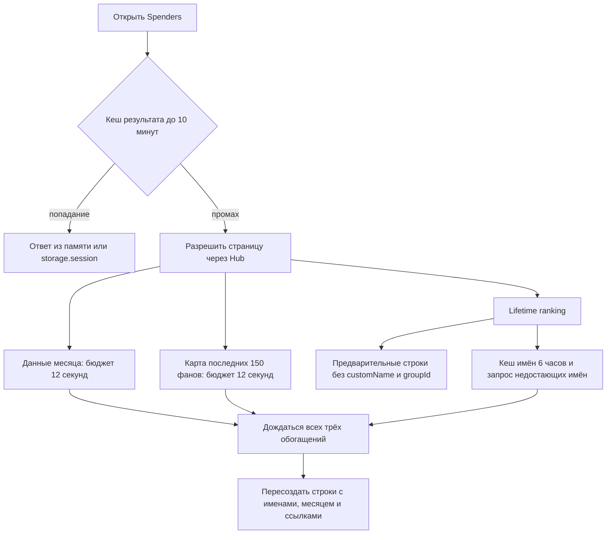

# Производительность Fansly extension: исследование 7 сентября 2026

Самые полезные следующие изменения: **показывать сохранённые имена Spenders сразу, обновлять строки точечно и быстрее реагировать на переход к другому фану**. Подтверждённых оснований начинать с виртуализации списка на 1000 строк нет. Есть отдельный механизм, который плохо масштабируется с длиной переписки: поиск области прокрутки при отсутствии рабочего DOM-кеша.

Исследован текущий рабочий каталог, включая незакоммиченный кандидат 2.0.0. HEAD: `1a74b8114235f95818425f49699178e5f451e29e`; один HEAD не описывает проверенный код. Контрольные суммы исходников находятся в `source-fingerprints.json`. Карты `docs/generated/` относятся к `1586f07` и использовались только для навигации. Выводы проверены по действующему коду и ограничениям CLAUDE.md / E23, E29–E31, E34, E75, E84.

Это исследование и воспроизводимые стенды. Код приложения, настройки, сборка `dist`, Fansly и Hub не изменялись. Запросов к рабочим Fansly/Hub и платных генераций не было.

## Что измерено, а что ещё неизвестно

1. Настоящий `SpendersBoardController` и текущий CSS исполнены в локальном Chromium 152, Apple M4 Pro, viewport 1280×720. Использованы вымышленные фаны: 100, 500, 1000 строк, одна прогревочная и пять учитываемых итераций для каждого размера.
2. Отдельно проверена структура работы DOM в jsdom: считаются вызовы, **не время реального Firefox layout**.
3. Путь загрузки Spenders проверен по исходникам и отдельным воспроизведениям с подставными HTTP-ответами и storage.
4. Запущены девять существующих наборов тестов: **275/275 прошли**. Это функциональная проверка выбранных путей, не доказательство отсутствия тормозов.

Профиль реальной вкладки Fansly в Firefox не снимался. Не измерены задержки рабочего Hub, реальные размеры inbox/переписки, конкурирующие расширения, сеть и нагрузка компьютеров чаттеров. Нельзя утверждать, что все жалобы на тормоза объясняются найденными механизмами.

**Обычный список фанов/чатов отрисовывает Fansly.** В этом репозитории нет собственного renderer нативного inbox, его unread-состояний и фильтров. Здесь можно уменьшить добавленную расширением нагрузку и задержку его реакции. Для оценки самого списка нужен сравнительный профиль одной и той же операции с расширением и без него.

## Текущий путь Spenders



Кеши уже существуют; холодные одновременные запросы одного контекста объединяются. Ranking берётся из Hub, а не из N запросов к earnings фанов. Lifetime и month запрашиваются параллельно после определения страницы. Имена запрашиваются пачками по 50, с паузой 300 мс, без повторов и с бюджетом 12 секунд; удалённые аккаунты исключены из сетевого поиска. Эти меры нужно сохранить.

## 1. Раньше показывать узнаваемые имена и готовые ссылки на чат

**Приоритет: высокий для пользовательского ожидания; механизм воспроизведён.**

`src/background/spenders-service.ts:914` формирует предварительный результат с двумя пустыми `Map`. Существующий кеш имён читается позже (`:1081`), а его результат попадает в UI только после `Promise.all` карты чатов, месяца и имён (`:960`). Поэтому даже полностью тёплый кеш custom names не помогает раннему показу имён, если один другой источник медленный. Ряды и lifetime уже доступны; задерживается их узнаваемость и состояние прямых ссылок.

В локальном воспроизведении кеш имени и карта чата готовы, сетевой запрос имени не нужен, месяц искусственно удержан. Предварительная строка имеет `customName=null`, `groupId=null`; готовые поля появляются только после освобождения месяца. Удержание необязательной работы ограничено её бюджетом, обычно до 12 секунд для этих веток; это **не измеренная задержка рабочего сервера**.

**Предложение:** после lifetime сразу наложить валидный кеш имён того же creator-контекста; готовую карту/месяц применять независимо от самой медленной ветки. Сетевой поиск имён продолжать в рамках существующих ограничений. Можно отдавать одну немедленную локальную поправку и объединять последующие изменения, чтобы не рисовать заново по каждой пачке.

Это нужно делать вместе с пунктом 2: дополнительные snapshots через нынешний `setBuildSnapshot` будут пересобирать весь board (`spenders-board-controller.ts:255`). Простое увеличение числа snapshots усугубит работу DOM.

**Критерий:** при мгновенном lifetime, валидном кеше имён и искусственно зависшем month знакомые имена появляются до завершения month; поиск, выделенный fanAccountId, фокус и IME продолжают работать. Знать groupId можно только после получения/проверки соответствующей карты. Контекстные fences и семантика неизвестных денежных полей сохраняются.

## 2. Обновлять существующие строки Spenders и пропускать неизменившийся поиск

**Приоритет: средний отдельно, необходимая основа для пункта 1.**

В `spenders-board-controller.ts:607–632` enrichment сохраняет оболочку и input, но вызывает `rowCache.clear()` и пересоздаёт все строки. Поиск использует кеш узлов, однако `renderList` переносит все совпавшие строки в `DocumentFragment`, переписывает индекс/класс и вызывает `replaceChildren` (`:653–667`, `:760`). Даже если запрос оставил тот же состав и порядок, происходит DOM commit.

Измерение на 1000 строк подтверждает:

- Предварительный показ создаёт 1000 строк; enrichment создаёт ещё 1000.
- Широкий поиск, который оставил всех фанов, новых строк не создаёт, но производит **1001 childList record и 2001 attribute record** под наблюдаемым корнем. Это число записей MutationObserver, не число reflow/кадров.
- На один переход курсора меняются только два класса: уже O(1).
- Закрытие оставляет ноль элементов board; утечка строк этим экспериментом не обнаружена.

**Предложение:** держать в row-view ссылки на имя, avatar, month, chat-state и обновлять только изменившиеся поля. Сопоставлять по `fanAccountId`, а не по индексу. Для поиска сравнивать последовательность полученных id: при том же составе/порядке не перемещать DOM. При изменении membership обновлять нужные узлы и секции. Предвычисление нормализованных поисковых строк и tier полезно только как небольшой следующий шаг: на 1000 элементов CPU-фильтрация сама по себе не показана главным ограничением.

**Критерий:** изменение одного имени сохраняет идентичность остальных 999 строк; одинаковый результат поиска не вызывает перемещения строк. Сохраняются выбор фана, поиск по customName/username, статусы удалённого аккаунта, доступность строк, фокус и навигация J/K/Enter.

**Соседнее улучшение UX:** сохранять текущий список видимым при Refresh, показывая состояние обновления. Сейчас `load` очищает ссылки и, когда прежний запрос уже завершён, обнуляет result и показывает loading (`:279–296`). При повторном открытии возможен краткий показ проверенного snapshot того же контекста с обязательной повторной проверкой через background. Не вводить бессрочный локальный кеш: background остаётся владельцем 10-минутного TTL. Это может убрать исчезновение списка, но экономия времени реального RPC не измерена.

### Результат браузерного стенда

В таблице медиана из пяти итераций, мс. Время включает синхронный вызов текущего метода и отдельный принудительный flush layout после него. Некоторые layout-read уже выполняются внутри метода; это **не чистое JS-время и не end-to-end latency/INP**. Paint и ожидание сети не измерены. Поиск не включает намеренный debounce 150 мс.

| Операция | 100 строк | 500 строк | 1000 строк | Максимум на 1000 |
|---|---:|---:|---:|---:|
| Предварительный показ | 2,2 | 7,0 | 13,9 | 14,4 |
| Enrichment | 2,0 | 8,0 | 14,4 | 17,5 |
| Поиск, совпадают все | 1,4 | 4,8 | 8,7 | 9,6 |
| Узкий поиск | 0,6 | 1,5 | 2,6 | 2,7 |
| Очистка поиска | 1,0 | 3,0 | 5,8 | 6,0 |
| Шаг курсора | 0,2 | 0,2 | 0,3 | 0,3 |
| Закрытие | 0,8 | 2,0 | 3,3 | 3,6 |

В итоговом DOM на 1000 строк — 9050 элементов с оболочкой. В выбранных операциях не измерен синхронный участок длиннее 50 мс. Это не основание обещать такой же результат на рабочей странице или слабом ПК.

## 3. Быстрее переключать состояние расширения при выборе фана

**Приоритет: высокий для ощущения отзывчивости; подтверждённая задержка алгоритма.**

`src/content/route-watcher.ts:8` проверяет URL таймером, `ROUTE_POLL_INTERVAL_MS=500` (`src/shared/constants.ts:202`). До реакции `handleRouteChange` номинально добавляется 0–500 мс, а при задержке таймеров и больше. Сам Fansly может уже показать выбранный чат. Это задержка toolbar/context расширения, не обязательно загрузки inbox.

**Предложение:** единая функция проверки маршрута, вызываемая сразу на `popstate` и после собственного перехода из Spenders. Polling оставить страховкой для неохваченных переходов Fansly; просто уменьшать интервал — менее полезная мера. Для остальных нативных переходов сперва выяснить реально доступный сигнал браузера/страницы. Не делать преждевременный context-ready по одному клику или URL: DOM нового чата должен пройти существующую проверку.

Отдельный хвост: `openFanChat` (`index.ts:1190–1217`) проверяет переход через 2 секунды по смене контейнера или displayName. Два фана с одинаковым именем и повторно использованным контейнером могут вызвать лишнюю полную загрузку. Это подтверждённое условие в коде, но его частота на живой странице не измерена. Улучшать доказательство перехода по идентичности чата; не убирать fallback вслепую.

**Критерий:** измерять `изменение pathname → route handler → toolbar нового чата`; отдельно native-chat-ready. Быстрые A→B→C, одинаковые имена, ignored popstate и замена textarea не должны оставлять действие привязанным к старому фану.

## 4. Не терять готовую карту чатов из-за сбоя следующей страницы

**Приоритет: средний, особенно на нестабильной сети/при ограничениях API.**

`listFanAccounts` использует общий retry policy: 429/5xx могут привести к четырём попыткам одной страницы с паузами 1, 2, 4 секунды (`fansly-client.ts:726`; constants `:76`). Если вторая страница падает, первая уже собранная часть карты не возвращается. Внешний best-effort catch превращает всё в `{ fans: [] }` (`spenders-service.ts:784–806`).

Локально воспроизведён сценарий: первая страница даёт 100 фанов, вторая отвечает HTTP 500 на каждую попытку. Получается **пять запросов, около 7,3 секунды и ноль сохранённых прямых chat ids**. Все ответы подставные; это не нагрузка на Fansly. Последующие клики могут потребовать отдельных inbox-search запросов вместо использования уже прочитанной карты.

**Предложение:** отдельная политика для необязательной карты Spenders — остановиться после ошибки/429, сохранить уже полученные пары fan→group, отметить неполное покрытие. Повторное чтение можно оставить явному Refresh. Не менять глобальную retry policy для остальных операций; session-expired и отмена родителя должны сохранить свою текущую семантику. Параллельные дополнительные запросы к Fansly здесь не нужны.

**Критерий:** при успехе первой страницы и сбое второй сохранены 100 корректных ссылок, отсутствует серия повторов необязательной страницы; ранний показ ranking не блокируется.

## 5. Ограничить поиск области прокрутки длинного чата

**Приоритет: средний; высокая стоимость при конкретном fallback-состоянии.**

`src/content/scroll-compensation.ts:54–75` обходит поддерево через TreeWalker и читает стиль каждого узла. Поиск соседних веток поднимается вверх (`:126–179`); найденный fallback намеренно не кешируется. В нестабильном/неподдержанном DOM это повторяется при следующем inline-render. При нормальном валидном кеше повторного полного обхода нет. Overlay/Coach уже исключены из этой компенсации (`index.ts:1268`).

В воспроизведении настоящий helper работает с вымышленным DOM, пять элементов на сообщение:

| Сообщений | Холодный поиск | Следующий, кеш валиден | Каждый fallback |
|---|---:|---:|---:|
| 100 | 506 style reads | 1 | 1014 |
| 1000 | 5006 | 1 | 10014 |
| 5000 | 25006 | 1 | 50014 |

**Предложение:** передавать известную область прокрутки от монтирования чата, ограничить fallback текущим conversation subtree и предусмотреть ограниченное повторное обнаружение при смене DOM. Инвалидировать кеш по реальному исчезновению/замене anchor. Не превращать ненайденный контейнер в вечный кеш: Angular может дорисовать его позже.

**Критерий:** после монтирования работа не растёт с количеством message descendants; при незавершённом DOM нет полного обхода на каждом кадре. Проверить сохранение позиции около конца чата, ручной скролл вверх и загрузку старых сообщений.

Числа выше — вызовы `getComputedStyle` в jsdom, **не тысячи подтверждённых reflow и не замер лагов Firefox**. Обоснование группировать чтения/записи layout: [web.dev](https://web.dev/articles/avoid-large-complex-layouts-and-layout-thrashing).

## 6. Убрать повторные DOM-поиски при вводе

**Приоритет: небольшой, изменение локальное.**

Глобальный capture listener `input/change` сначала вызывает `findActiveConversationTextarea` даже для Spenders search/Coach (`index.ts:446–458`). При вводе в настоящий composer поиск повторяется через `computeHasDraftText`, а при переходе пусто↔непусто — через `renderButtonBar → syncDraftTextareaObserver` (`:4035`). Resolver заодно вычисляет displayName, хотя для чтения value это не нужно (`conversation-dom.ts:68–115`).

Счётчик настоящего resolver, вызванного 1/2/3 раза согласно этому пути, дал соответственно **4/8/12 querySelector и 1/2/3 offsetParent read**. Это моделирование кратности обработчика, не полный end-to-end input event.

**Предложение:** дешёвая проверка типа/принадлежности event.target до поиска; разрешить live textarea один раз и прочитать её value. Разделить поиск textarea и полное извлечение conversation metadata. Сохранить делегированный listener: существующий функциональный фикс нужен для textarea, создаваемой/заменяемой Fansly при focus.

## 7. Общая производительность: узкие следующие кандидаты

**Coach debug.** `overlay-controller.ts:2049` пересоздаёт все строки pending debug log при обновлениях, даже если snapshot тот же и `<details>` закрыт. Счётчик на 100 обновлений с неизменными 20 строками лога показал 6000 созданных элементов и 100 замен children; без profiling — ноль. Простой revision/reference guard или добавление новых строк устраняет лишнюю работу. Это debug-only путь; агрегированное время в jsdom невелико и не доказывает причину обычных пользовательских лагов.

**Voice render.** rAF уже объединяет обновления, но `voice-panel.ts:550` вызывает все секции панели; source/tones/busy пересоздают статические кнопки (`:620`, `:646`, `:712`). При script delta можно обновлять editor/meta, при status delta — затронутую карточку. Стоимость не измерена. Существующие keyed media nodes нужно сохранить, включая непрерывность проигрывания и восстановление paid attempts.

**Сборка.** Lazy bootstrap уже отделён от chat app. Дополнительное выделение Voice возможно: измерение esbuild metafile относит около 75 KB из 446 KB chat bundle к Voice. Это потенциальное уменьшение parse/startup работы; его влияние на время открытия не измерено. Числа — несжатый JS вклад в сборку, не память и не экономия сетевого трафика расширения.

**Coach history и storage.** Повторный обход/разбор всей истории при пересборке модели и нормализация всех recap при некоторых storage patches существуют, но локальные эксперименты не показали оснований поставить их раньше списка/навигации. Memoization по revision имеет смысл после профиля реального размера истории. Перенос в Worker заранее не обоснован.

**Hub discovery.** Новый build последовательно ждёт `/pages` для определения pageLabel (`spenders-service.ts:853`, `agency-hub-client.ts:295`), лишь затем запускает ranking. Объединение одинаковых discovery-запросов или короткий кеш с учётом Hub/principal может убрать один RTT. Board cache уже снижает частоту этой работы; рабочий RTT и необходимость дополнительного кеша не измерены. Замедление SQL этим исследованием не установлено.

## Что уже сделано хорошо и не требует повторной реализации

- Кеш board в памяти и storage.session; кеш имён в storage.local с TTL и ограничением размера.
- Ранний lifetime snapshot и объединение одновременных холодных build одного контекста.
- Ограниченные и разнесённые по источникам запросы; отсутствие N запросов earnings на каждого spender.
- Сохранение поискового input/focus при финальном enrichment; debounce, row cache, O(1) cursor.
- MutationObserver отбрасывает собственные изменения ChatGoose, объединяет внешние события и обычно проверяет anchors, а не сканирует все строки inbox.
- Streaming уже объединяется через requestAnimationFrame, ряд DOM-узлов стабилен, тяжёлый app/CSS подключаются лениво.
- Смена аккаунта/Hub и незавершённые ответы защищены generations/context keys. Оптимизации должны опираться на эти гарантии.

## Порядок внедрения и проверка результата

1. **Spenders:** точечный row update + ранний показ кешированных имён; затем независимое обогащение. Это одна связанная работа.
2. **Навигация:** немедленная проверка route для известных событий; сохранить fallback и проверку актуального чата.
3. **Деградация сети:** сохранить частичную chat map и ограничить необязательные retry.
4. **DOM:** ограничить scroll discovery и убрать повторный поиск composer; проверить на длинной переписке.
5. **Небольшие хвосты:** debug-log guard. Voice splitting и memoization — после профиля.

Виртуализацию отложить до актуального Firefox-профиля, как требует существующее E30/E31. Исторические июльские числа из E31 не выдаются здесь за текущую проверку. Если профиль покажет layout/paint bottleneck, сравнить точечные обновления, CSS containment / `content-visibility: auto`, затем windowing видимых строк. CSS не устраняет стоимость создания DOM; windowing усложняет поиск браузера, доступность, клавиатуру и выбор фана. [MDN о content-visibility](https://developer.mozilla.org/en-US/docs/Web/CSS/Reference/Properties/content-visibility).

Не расширять лимит 1000 и не добавлять простую offset-пагинацию рейтинга: при необходимости полного списка сверх лимита требуется Hub-контракт со стабильным snapshot/cursor. Это вопрос полноты данных, а не ускорения текущей отрисовки. Live-чтение переписки нельзя заменить отстающим архивом Hub.

Для рабочего Firefox: профиль с включённым JS, отдельно запись с расширением/без; переключения чатов, composer input, Spenders cold/warm/Refresh/search, inline streaming и длинная переписка. Собирать времена до первой строки, до custom names и до chat-ready отдельно от layout/paint и API. Long task >50 мс — сигнал разбираться, а не обещание полного отсутствия проблем ниже порога. [Инструкция Mozilla](https://firefox-source-docs.mozilla.org/performance/reporting_a_performance_problem.html), [разбиение длинных задач](https://web.dev/articles/optimize-long-tasks).

## Воспроизведение

Команды выполняются из корня репозитория. Стенды используют установленные esbuild/jsdom; ничего не скачивают и не обращаются к Fansly/Hub. Browser benchmark использует внутренние методы controller только для измерения, не имитирует полный extension lifecycle.

```sh
node docs/research/performance-2026-09-07/serve.mjs
# Открыть напечатанный loopback URL, нажать Run benchmark.
# serve.mjs собирает только стенд в память, не меняет dist.

node docs/research/performance-2026-09-07/scroll-counts.mjs
node docs/research/performance-2026-09-07/input-counts.mjs
node docs/research/performance-2026-09-07/service-cached-names-probe.mjs
node docs/research/performance-2026-09-07/service-chat-map-probe.mjs
# Второй service probe занимает около 7,3 с из-за настоящих retry delays.
node docs/research/performance-2026-09-07/general-probe.mjs
# General probe пишет временный bundle/результат в /tmp, не в dist.

pnpm exec vitest run tests/spenders-board-controller.test.ts tests/spenders-service.test.ts tests/spenders.test.ts tests/conversation-mount-controller.test.ts tests/scroll-compensation.test.ts tests/content-app.test.ts tests/overlay-controller.test.ts tests/storage-coordinator.test.ts tests/bootstrap-keepalive.test.ts
```

`results.json` содержит все 126 браузерных измерений, включая прогревочные, browser/viewport и timestamp. `scroll-counts.jsonl` / `input-counts.jsonl` содержат счётчики DOM. Дополнительные service/general probes и их результаты сохранены рядом. Полный `pnpm check` для исследования не запускался; его необходимо выполнить после реализации изменений, перед коммитом.
